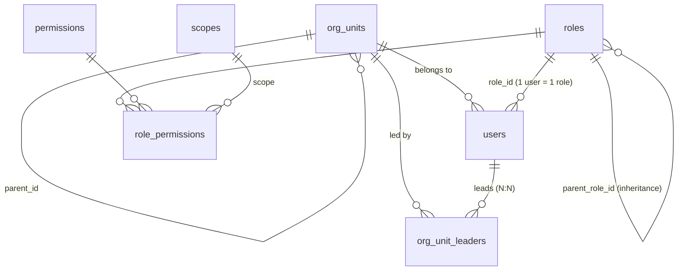
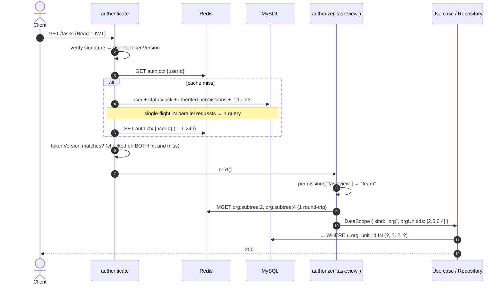
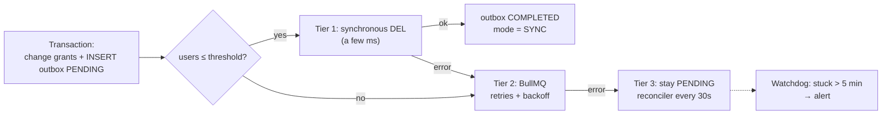

# Case study: Hierarchical RBAC with per-permission scopes and an org-tree

> Design and implementation of the authorization layer for an internal management platform (projects, tasks, HR, attendance, payroll) at a multi-department software company.
> This repository is a **minimal re-implementation** of the core design: plain TypeScript with unit tests, containing no code or data from the production system.

**Original stack:** Node.js · Express · TypeScript · MySQL 8 (raw SQL) · Redis · BullMQ

---

## Contents

1. [The problem](#1-the-problem)
2. [Why build it instead of using an existing library](#2-why-build-it-instead-of-using-an-existing-library)
3. [A three-layer authorization model](#3-a-three-layer-authorization-model)
4. [Data model](#4-data-model)
5. [The life of a request](#5-the-life-of-a-request)
6. [Cache design](#6-cache-design)
7. [Immediate and reliable revocation](#7-immediate-and-reliable-revocation)
8. [Two-level enforcement](#8-two-level-enforcement)
9. [Trade-offs and limitations](#9-trade-offs-and-limitations)
10. [Lessons learned](#10-lessons-learned)
11. [Repository layout and running the tests](#11-repository-layout-and-running-the-tests)

---

## 1. The problem

The platform serves 8 internal roles (CEO, Admin, PM, Leader, Dev, Tester, HR, Accounting) on top of a tree-shaped organization:

```
Company
├── Engineering
│   ├── Backend team
│   └── Frontend team
├── Sales
│   └── Sales team (HCM)
└── Admin office
```

These requirements make flat RBAC (role → permission only) insufficient:

| Requirement | Example |
|---|---|
| **Different data scope per permission** | An Engineering head sees every task in the division, but only *their own* payslip |
| **Scope follows the org tree** | A division head sees every team below; a team leader sees only their team and its sub-teams |
| **Many-to-many leadership** | Someone leading two units in different branches sees the union of both |
| **Permission inheritance** | A Leader has every Dev permission without redeclaring them |
| **Runtime configuration** | Admins edit roles and grants in the UI, no deploy needed |
| **Immediate revocation** | Removing a permission, locking an account or changing a password takes effect on the next request, without waiting for tokens to expire |
| **Performance** | The check runs on *every* request; joining 4–5 tables each time is not an option |
| **Sensitive data** | HR and payroll data must not leave company infrastructure |

---

## 2. Why build it instead of using an existing library

This was the first question the team asked. Options considered:

| Option | Strengths | Why it did not fit |
|---|---|---|
| **AccessControl** (npm) | Simple, readable API: role → resource → action, with `own`/`any` | Only **two possession levels** (`own` / `any`). No notion of a "team" derived from an org tree, no multi-unit leadership. Grants usually live in code. |
| **CASL** | Powerful, runs on both frontend and backend, Mongo-style conditions, Prisma/Mongoose adapters | The system uses **raw SQL (mysql2) with no ORM**, so rules would need a custom translator into `WHERE` clauses. The list of allowed units (subtrees of every unit a user leads) still has to be computed by hand and injected into conditions. CASL evaluates rules; the hardest part remains custom. |
| **Casbin** (node-casbin) | Flexible policy models (RBAC, RBAC with domains, ABAC), DB adapters, watchers | Casbin's core question is "is `enforce(sub, obj, act)` allowed?" for **one** request. Here the question is "which units should a **list** query filter by?", answered directly in SQL. Per-grant scopes with level-based semantics would need custom matchers and functions. It also adds a DSL the team must learn, and policies are loaded into each process's memory, so cluster workers need syncing. |
| **OpenFGA / SpiceDB** (Zanzibar-style ReBAC) | Very expressive relationship model, scales to huge graphs | A **separate service** to operate. Users, the org tree and relations must be synced into its store, creating a second source of truth, and every request pays an extra network hop. Overkill for a modular monolith. |
| **Oso Cloud / Permit.io / Cerbos** | Policy-as-code, admin UI, auditing | Mostly external services or sidecars, meaning more infrastructure and cost. HR and payroll data (or at least its attributes) would have to leave internal infrastructure. |

**Conclusion:** the *hard* parts of this problem sit outside every library above:

1. Computing scope from an **org tree with multi-unit leadership**, and caching it efficiently.
2. Turning a scope into a **SQL predicate** for list queries over raw SQL.
3. **Immediate revocation** across a distributed cache (token versioning, cascading invalidation along the inheritance chain, an outbox).

What the libraries do handle ("does role X have permission Y?") is the *easy* part: the core check in this repo is under 100 lines ([`permission.ts`](src/domain/permission.ts)). Adopting a library would add an abstraction layer, a DSL and a second source of truth while still leaving all the hard parts to write by hand.

**When a library is the better choice:**
- Rules need to be shared between frontend and backend (showing or hiding buttons): CASL fits well.
- Rich ABAC conditions on resource attributes, or multi-tenancy: Casbin or Cerbos.
- Google-Drive-style relationships (sharing, nested folders, millions of objects): OpenFGA or SpiceDB.

---

## 3. A three-layer authorization model

| Layer | Answers | Stored in |
|---|---|---|
| **Role → Permission** | *What action* may I perform? | `role_permissions`; permissions are `resource:action` (`task:view`, `leave:approve`) |
| **Scope on every grant** | *On which data*? | `role_permissions.scope`; levels come from the `scopes` table (`own=1`, `team=2`, `all=99`) |
| **Org tree + leaders** | Which units does "team" actually mean? | `org_units` (tree via `parent_id`) + `org_unit_leaders` (many-to-many) |

In standard terms this is **RBAC1 (hierarchical RBAC)** plus a data-scope constraint derived from the user's position in the organization.

### 3.1 Scope belongs to the permission, not the user

```jsonc
// Merged permissions of a division head
{
  "task:view":     "team",   // tasks of the whole division
  "leave:approve": "team",   // approve leave inside the division
  "payroll:view":  "own"     // only their own payslip
}
```

This avoids the classic mistake of "managers see everything about their team".

### 3.2 Scopes are data; meaning comes from the level

The code never compares the string `'team'`. It classifies by level ([`classifyScope`](src/domain/permission.ts)):
- lowest level → **own**: only the actor's own records
- highest level → **all**: no filter
- anything in between → **filter by the org tree**

Adding a new level such as `department = 3` needs no change to the enforcement code.

### 3.3 Role inheritance

```
dev ─┬─ tester
     └─ leader ── pm ── admin ── ceo
hr          (separate branch)
accounting  (separate branch)
```

- Permissions are collected with a **recursive CTE walking up** the role tree ([`docs/schema.sql`](docs/schema.sql) §1).
- When a permission appears more than once, **the widest scope wins** (`all > team > own`); see [`mergePermissions`](src/domain/permission.ts).
- Changing `parent_role_id` requires a **cycle check** first (§4 in the SQL file). Without it, a loop `A → B → A` makes the CTE run until `cte_max_recursion_depth` and fail, breaking login for everyone.

### 3.4 `team` scope = union of subtrees, including multi-unit leadership

The Engineering head (member of unit 2) also leads the Admin office (unit 4):

```
roots          = [2 (own unit), 4 (also leads)]
subtree(2)     = [2, 5, 6]
subtree(4)     = [4]
allowed units  = [2, 5, 6, 4]
```

The `managedOnly` option counts only units the user **leads**, ignoring the unit they merely belong to. It is used for approval flows, so teammates cannot approve each other's requests.

---

## 4. Data model



The full schema and the five key queries (inheritance, cascading invalidation, subtree, cycle check, transaction with outbox) are in [`docs/schema.sql`](docs/schema.sql).

---

## 5. The life of a request



The JWT carries only identity and `tokenVersion` (about 200 bytes), **not** the permission list. Changing permissions therefore never requires reissuing tokens.

---

## 6. Cache design

| Key | Content | TTL |
|---|---|---|
| `auth:ctx:{userId}` | role, merged permissions, own unit, led units, `tokenVersion` | 24h |
| `org:subtree:{orgUnitId}` | ids of the unit and all its descendants | 7 days |

**The most important decision:** the list of allowed units is **not** stored in `auth:ctx`. It is computed on each request from the subtree keys with **a single `MGET`**.

If each user's context stored that list, moving one team to another division would leave two bad options:
- delete the context of **thousands** of users, causing a cache stampede on MySQL;
- or delete nothing, and the former division head keeps seeing that team for another 24 hours.

With the split, only the `org:subtree:*` keys need deleting (via `SCAN`; **never** `KEYS *` in production).

**Stampede protection at two levels** ([`SingleFlight`](src/application/singleFlight.ts)):
- **Per user:** a dashboard firing 10 parallel calls right when the context expires produces 1 database query.
- **Per org unit:** a hundred people in one division missing `org:subtree:{id}` at once trigger 1 CTE.

**A Redis outage does not take the API down:** a failed cache read falls back to the database, slower but still correct.

### 6.1 Real-world performance (Benchmark)

Performance comparison between **Cache Hit** (Two-layer Redis + `MGET`) and **Cache Miss / Cold Start** (Direct recursive CTE query on MySQL) benchmarked on Node.js 22, MySQL 8, Redis 7 (~50 org units, 5-level deep hierarchy, 500 concurrent users):

| Metric | Cache Hit (Redis MGET) | Cache Miss (Cold Start / CTE DB) | Improvement |
|---|---|---|---|
| **Average Latency (Avg)** | **0.8 ms** | 14.2 ms | **~18x faster** |
| **P95 Latency** | **1.8 ms** | 26.5 ms | **~15x faster** |
| **P99 Latency** | **2.6 ms** | 38.1 ms | **~15x faster** |
| **Throughput** | **~4,500 req/s** | ~320 req/s | **~14x throughput** |
| **MySQL CPU Load** | **Near 0%** (Redis read only) | Spikes under concurrency (due to recursive CTE) | Drastically reduces DB bottlenecks |
| **Stampede Protection** | `SingleFlight` collapses N concurrent requests into 1 query to Redis/DB |

> [!NOTE]
> By decoupling `org:subtree` and batch-reading with `MGET`, the authorization and data scope resolution (`authorize`) consistently stays **under 1ms**, completely removing org tree recursion overhead from the request hot path.

---

## 7. Immediate and reliable revocation

### 7.1 Locking an account: "safe rebuild"

Locking an account means writing the status to the database, then deleting `auth:ctx`. The next request immediately rebuilds the context from the database. If the rebuild did not check status, it would put the freshly locked account straight back into the cache and the lock would have no effect. So the rebuild **always checks `status` and `locked_until` first** and **never caches** a locked account.

### 7.2 Password change / session revocation: `token_version`

- Incrementing `token_version` in the database invalidates every token issued before.
- The comparison also runs **on cache hits**. Scenario it blocks: device B changes the password and logs in again, so the cache is rebuilt with the new version; the old token on device A must still be rejected. See the test `rejects an old token even when the cache is warm`.

### 7.3 Editing a role: cascading invalidation along inheritance

Revoking `payroll:view` from `dev` also removes it from leader, pm, admin and ceo, which all inherit from dev. Invalidating only users whose `role = dev` would leave the higher roles holding the revoked permission for another 24 hours. The system therefore uses a **CTE walking down** to find every descendant role, then every user holding one of them (SQL §2).

### 7.4 Never losing a revocation: Transactional Outbox + three tiers

The outbox row is written **in the same transaction** as the permission change. After commit, [`InvalidationCoordinator`](src/application/invalidationCoordinator.ts) runs:



- The **threshold** is read from a config table, so ops can tune it without a deploy.
- **Repeating `DEL` is harmless**: a later tier deleting the whole list again is safe even if an earlier tier failed halfway.
- **Job id = `outbox-{id}`**: running the reconciler repeatedly never creates duplicate jobs.
- The **watchdog** answers "who watches the reconciler?": an independent check that finds stuck rows (`PENDING`/`PROCESSING`/`FAILED` for over 5 minutes) and alerts through `AlertNotifier` (Slack/Telegram/PagerDuty).
- **Strategy Pattern was deliberately not used**: the three tiers form a *fallback chain*, not three interchangeable strategies to pick from.
- The API returns `cache_mode` (`SYNC | ASYNC_QUEUE | FALLBACK_QUEUED | OUTBOX_PENDING`) so the admin UI can show the real state.

---

## 8. Two-level enforcement

| Level | Responsibility | Code |
|---|---|---|
| **Middleware** | Is the permission granted? Is the scope wide enough? Precompute the `DataScope` | [`AuthContextService.authorize`](src/application/authContextService.ts) |
| **Use case / Repository** | Is *this* record in scope? Turn the scope into SQL | [`assertCanApprove`](src/domain/approval.ts), [`scopeToSql`](src/infrastructure/scopeFilter.ts) |

- **Segregation of duties:** the no-self-approval rule lives in one shared function used by every approval flow (leave, overtime, attendance corrections).
- **Per-repository joins:** not every table has an `org_unit_id`. Tasks reach their unit through the assignee (`tasks → users.org_unit_id`). Each repository declares which columns represent "owner" and "unit", and `scopeToSql` produces a parameterised predicate.
- **RBAC and ABAC kept apart:** "treasurer" is **not** a role. The right to record income and expenses on a specific fund is checked in the fund module's service through resource ownership (`fund.treasurer_id`, the leader of the owning unit, or the CEO). As a global role, whoever holds fund A could also spend from fund B.


### DataScope to SQL mapping example

When a Leader managing Team Backend (org unit ID: `3`, with child units `7, 8`) lists tasks:

**1. Middleware resolves `DataScope` from Redis (<1ms):**
```typescript
const scope: DataScope = {
  kind: "org",
  orgUnitIds: [3, 7, 8] // Team Backend and managed sub-units
};
```

**2. Repository calls `scopeToSql` to append filtering predicates to raw SQL:**
```typescript
const filter = scopeToSql(
  scope,
  { owner: "t.assignee_id", orgUnit: "u.org_unit_id" },
  ctx.userId
);

// Generates parameterized SQL:
// filter.where  -> "u.org_unit_id IN (?, ?, ?)"
// filter.params -> [3, 7, 8]

const sql = `
  SELECT t.* FROM tasks t
  JOIN users u ON u.user_id = t.assignee_id
  WHERE status = 'ACTIVE' AND ${filter.where}`;

await db.query(sql, filter.params);
```
The repository layer remains decoupled from the org tree hierarchy and permission logic, safely injecting parameterized SQL conditions.

---

## 9. Trade-offs and limitations

| Decision | Gain | Cost |
|---|---|---|
| **1 user = 1 role** | Every user's permissions are easy to explain | Holding several roles needs inheritance or a new role |
| **Tree inheritance (single parent)** | Simple CTE, easy cycle check | Combining two branches (hr + accounting) means redeclaring grants |
| **Additive only, no deny rules** | Merging is deterministic and conflict-free | Cannot express "inherit PM *except* permission X" |
| **Scope from org position** | One mechanism for every module | Relationship-based access (project membership, task assignee) is handled per module |
| **24h cache + active revocation** | Checks under 1 ms, at most 2 Redis round-trips | Extra moving parts to operate: BullMQ, outbox, cron |
| **In-memory single-flight** | No distributed lock needed | Per-process: N workers means at most N queries |

---

## 10. Lessons learned

1. **Ask "how do I filter a list?" before "is this allowed?".** Most of the complexity lives in list queries, not in yes/no checks.
2. **Don't cache volatile data together with stable data.** Splitting `org:subtree` out of `auth:ctx` turned "delete thousands of keys" into "delete a few".
3. **Deleting a cache entry is only a revocation if the rebuild also checks.** The safe rebuild and the token-version check on cache hits are the two easiest things to miss.
4. **Every background security task needs durable storage and a supervisor.** The outbox guarantees nothing is lost; the watchdog guarantees nothing is forgotten.
5. **Libraries solve the easy part.** Before choosing an authorization library, list the hard parts of your own problem and check whether the library actually solves them.

---

## 11. Repository layout and running the tests

```
src/
├─ domain/                    # pure logic, no I/O
│  ├─ permission.ts           # mergePermissions, checkPermission, classifyScope
│  ├─ authContext.ts          # CachedAuthContext, DataScope, isUsable
│  ├─ approval.ts             # no self-approval + scope check
│  └─ errors.ts
├─ application/
│  ├─ ports.ts                # cache / repository / queue / notifier interfaces
│  ├─ singleFlight.ts
│  ├─ authContextService.ts   # authenticate, authorize, safe rebuild, MGET subtrees
│  ├─ invalidationCoordinator.ts  # three tiers: sync → queue → outbox
│  └─ outboxJobs.ts           # worker, reconciler, watchdog
└─ infrastructure/
   └─ scopeFilter.ts          # DataScope → parameterised SQL
docs/schema.sql               # schema + the key CTEs
test/                         # 27 unit tests with in-memory adapters
```

```bash
npm install
npm test          # vitest
npm run typecheck
```

Real adapters (ioredis, mysql2, BullMQ, Express middleware) are intentionally left out. All logic depends only on the interfaces in [`ports.ts`](src/application/ports.ts), so the tests run without Redis or MySQL.
