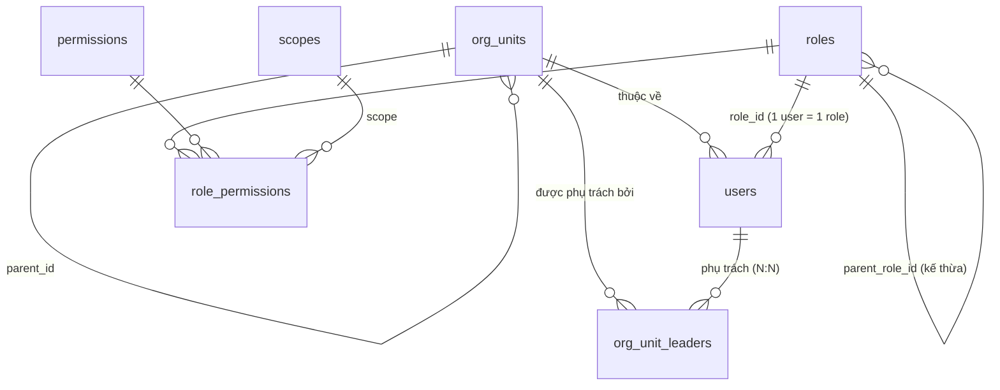
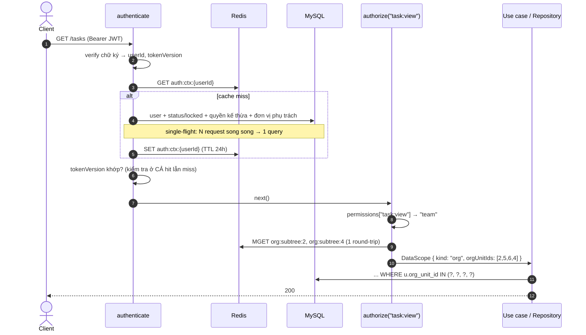
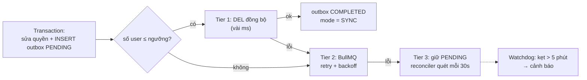

# Case study: RBAC phân cấp với scope theo từng quyền và cây tổ chức

> Thiết kế và hiện thực lớp phân quyền cho một hệ thống quản trị nội bộ (dự án, task, nhân sự, chấm công, lương) của một công ty phần mềm nhiều phòng ban.
> Repo này là **bản tái hiện tối giản** phần lõi của thiết kế: TypeScript thuần, có unit test, không chứa code hay dữ liệu của hệ thống thật.

**Stack của hệ thống gốc:** Node.js · Express · TypeScript · MySQL 8 (raw SQL) · Redis · BullMQ

---

## Mục lục

1. [Bài toán](#1-bài-toán)
2. [Vì sao tự viết thay vì dùng thư viện có sẵn](#2-vì-sao-tự-viết-thay-vì-dùng-thư-viện-có-sẵn)
3. [Mô hình phân quyền 3 lớp](#3-mô-hình-phân-quyền-3-lớp)
4. [Mô hình dữ liệu](#4-mô-hình-dữ-liệu)
5. [Một request đi qua hệ thống như thế nào](#5-một-request-đi-qua-hệ-thống-như-thế-nào)
6. [Thiết kế cache](#6-thiết-kế-cache)
7. [Thu hồi quyền tức thì và tin cậy](#7-thu-hồi-quyền-tức-thì-và-tin-cậy)
8. [Kiểm quyền ở 2 tầng](#8-kiểm-quyền-ở-2-tầng)
9. [Đánh đổi và giới hạn](#9-đánh-đổi-và-giới-hạn)
10. [Bài học rút ra](#10-bài-học-rút-ra)
11. [Cấu trúc repo và chạy test](#11-cấu-trúc-repo-và-chạy-test)

---

## 1. Bài toán

Hệ thống phục vụ 8 vai trò nội bộ (CEO, Admin, PM, Leader, Dev, Tester, HR, Kế toán) trên một cơ cấu tổ chức dạng cây:

```
Công ty
├── Khối Công nghệ
│   ├── Team Backend
│   └── Team Frontend
├── Khối Kinh doanh
│   └── Team Sales HCM
└── Phòng Hành chính
```

Các yêu cầu khiến RBAC "phẳng" (chỉ có role → permission) không đủ dùng:

| Yêu cầu | Ví dụ |
|---|---|
| **Phạm vi dữ liệu khác nhau cho từng quyền** | Trưởng khối xem task của cả khối, nhưng chỉ xem phiếu lương *của mình* |
| **Phạm vi theo cây tổ chức** | Trưởng khối thấy mọi team bên dưới; Leader chỉ thấy team mình và các nhóm con |
| **Kiêm nhiệm N:N** | Một người phụ trách hai đơn vị ở hai nhánh khác nhau thì thấy hợp dữ liệu của cả hai |
| **Kế thừa quyền** | Leader có mọi quyền của Dev mà không phải khai báo lại |
| **Cấu hình động** | Admin sửa role/quyền trên giao diện, không cần deploy |
| **Thu hồi tức thì** | Tước quyền, khoá tài khoản, đổi mật khẩu thì có hiệu lực ngay ở request kế tiếp, không đợi token hết hạn |
| **Hiệu năng** | Kiểm quyền chạy trên *mọi* request, không được JOIN 4–5 bảng mỗi lần |
| **Dữ liệu nhạy cảm** | Hồ sơ nhân sự và lương không được rời khỏi hạ tầng của công ty |

---

## 2. Vì sao tự viết thay vì dùng thư viện có sẵn

Đây là câu hỏi đầu tiên team đặt ra. Các lựa chọn đã xem xét:

| Lựa chọn | Mạnh ở đâu | Vì sao không khớp bài toán này |
|---|---|---|
| **AccessControl** (npm) | Đơn giản, API dễ đọc: role → resource → action, có `own`/`any` | Chỉ có **2 mức possession** (`own` / `any`). Không có khái niệm "team" theo cây tổ chức, không có kiêm nhiệm. Grant thường khai báo trong code. |
| **CASL** | Mạnh, chạy được cả FE/BE, điều kiện kiểu Mongo query, có adapter cho Prisma/Mongoose | Hệ thống dùng **raw SQL (mysql2), không ORM**, nên phải tự viết lớp chuyển rule thành câu `WHERE`. Danh sách đơn vị được phép (cây con của các đơn vị phụ trách) vẫn phải tự tính rồi nhét vào điều kiện. CASL chỉ đánh giá rule, phần khó nhất vẫn phải tự làm. |
| **Casbin** (node-casbin) | Mô hình policy linh hoạt (RBAC, RBAC có domain, ABAC), có adapter DB và watcher | Câu hỏi chính của Casbin là "`enforce(sub, obj, act)` có được không?" trên **một** yêu cầu. Còn bài toán ở đây cần trả lời "lọc **danh sách** theo những đơn vị nào?" ngay trong SQL. Scope gắn trên từng grant và ý nghĩa theo level phải viết matcher/function tuỳ biến, thêm một DSL cho team phải học, và policy nạp vào bộ nhớ từng process nên cần đồng bộ giữa các worker. |
| **OpenFGA / SpiceDB** (Zanzibar, ReBAC) | Mô hình quan hệ rất mạnh, scale lớn | Là **một service riêng** cần vận hành, phải đồng bộ user, cây tổ chức và quan hệ sang store của nó (thêm một nguồn sự thật), thêm một network hop mỗi request. Quá tay với một modular monolith. |
| **Oso Cloud / Permit.io / Cerbos** | Policy-as-code, có UI quản trị, audit | Phần lớn là dịch vụ ngoài hoặc sidecar: thêm hạ tầng và chi phí. Dữ liệu nhân sự/lương phải đưa ra ngoài (hoặc ít nhất là thuộc tính của chúng), không phù hợp yêu cầu giữ dữ liệu nhạy cảm nội bộ. |

**Kết luận:** những phần *khó* của bài toán đều nằm ngoài phạm vi của mọi thư viện kể trên:

1. Tính phạm vi theo **cây tổ chức có kiêm nhiệm** và cache nó hiệu quả.
2. Chuyển phạm vi thành **điều kiện SQL** cho các truy vấn danh sách trên raw SQL.
3. **Thu hồi quyền tức thì** trên cache phân tán (token version, xoá cache theo dây chuyền kế thừa, outbox).

Phần thư viện làm được (tra "role X có quyền Y không") lại là phần *dễ*: lõi kiểm quyền trong repo này chưa tới 100 dòng ([`permission.ts`](src/domain/permission.ts)). Dùng thư viện sẽ tốn thêm một lớp trừu tượng, một DSL và một nguồn sự thật thứ hai, trong khi vẫn phải tự viết toàn bộ phần khó.

**Khi nào nên dùng thư viện thay vì tự viết:**
- Cần chia sẻ rule giữa FE và BE (ẩn/hiện nút): CASL rất hợp.
- Điều kiện ABAC phức tạp theo thuộc tính tài nguyên, nhiều tenant: Casbin hoặc Cerbos.
- Quan hệ kiểu Google Drive (share, folder lồng nhau, hàng triệu object): OpenFGA hoặc SpiceDB.

---

## 3. Mô hình phân quyền 3 lớp

| Lớp | Trả lời câu hỏi | Lưu ở đâu |
|---|---|---|
| **Role → Permission** | Được làm *hành động gì*? | `role_permissions`, permission dạng `resource:action` (`task:view`, `leave:approve`) |
| **Scope trên từng grant** | Trên *phạm vi dữ liệu nào*? | Cột `scope` của `role_permissions`; mức độ lấy từ bảng `scopes` (`own=1`, `team=2`, `all=99`) |
| **Cây tổ chức + người phụ trách** | "Team" cụ thể là *những đơn vị nào*? | `org_units` (cây theo `parent_id`) + `org_unit_leaders` (N:N) |

Theo phân loại chuẩn, đây là **RBAC1 (hierarchical RBAC)** cộng thêm ràng buộc phạm vi dữ liệu dựa trên vị trí của user trong tổ chức.

### 3.1 Scope gắn trên từng permission, không gắn trên user

```jsonc
// Quyền đã gộp của một Trưởng khối
{
  "task:view":     "team",   // thấy task cả khối
  "leave:approve": "team",   // duyệt nghỉ phép trong khối
  "payroll:view":  "own"     // chỉ thấy lương của mình
}
```

Cách này tránh được lỗi kinh điển "là quản lý thì thấy hết mọi thứ của team".

### 3.2 Scope là dữ liệu, ý nghĩa suy ra từ level

Code không so sánh chuỗi `'team'`. Nó phân loại theo level ([`classifyScope`](src/domain/permission.ts)):
- level thấp nhất là **own**: chỉ bản ghi của chính mình
- level cao nhất là **all**: không lọc
- level ở giữa là **lọc theo cây đơn vị**

Thêm một mức mới như `department = 3` không cần sửa code kiểm quyền.

### 3.3 Kế thừa role

```
dev ─┬─ tester
     └─ leader ── pm ── admin ── ceo
hr          (nhánh riêng)
accounting  (nhánh riêng)
```

- Quyền được gom bằng **CTE đệ quy đi ngược lên** role cha ([`docs/schema.sql`](docs/schema.sql) §1).
- Trùng quyền thì **lấy scope rộng nhất** (`all > team > own`), xem [`mergePermissions`](src/domain/permission.ts).
- Trước khi đổi `parent_role_id` phải **kiểm tra chu trình** (§4 trong SQL). Thiếu bước này, một vòng `A → B → A` sẽ làm CTE chạy đến `cte_max_recursion_depth` rồi văng lỗi, gãy luồng đăng nhập của mọi người.

### 3.4 Scope `team` = hợp các cây con, có kiêm nhiệm

Trưởng khối Công nghệ (thuộc đơn vị 2), đồng thời kiêm phụ trách Phòng Hành chính (4):

```
roots          = [2 (đơn vị trực tiếp), 4 (kiêm nhiệm)]
subtree(2)     = [2, 5, 6]
subtree(4)     = [4]
allowed units  = [2, 5, 6, 4]
```

Option `managedOnly` chỉ tính các đơn vị **phụ trách**, bỏ đơn vị mình chỉ là thành viên. Dùng cho luồng duyệt: đồng nghiệp cùng team không duyệt đơn của nhau được.

---

## 4. Mô hình dữ liệu



Schema đầy đủ và 5 câu SQL quan trọng (kế thừa, xoá cache theo dây chuyền, cây con, kiểm tra chu trình, transaction kèm outbox) nằm trong [`docs/schema.sql`](docs/schema.sql).

---

## 5. Một request đi qua hệ thống như thế nào



JWT chỉ chứa định danh và `tokenVersion` (khoảng 200 byte), **không** chứa danh sách quyền. Đổi quyền vì thế không cần cấp lại token.

---

## 6. Thiết kế cache

| Key | Nội dung | TTL |
|---|---|---|
| `auth:ctx:{userId}` | role, permissions đã gộp, đơn vị trực tiếp, đơn vị phụ trách, `tokenVersion` | 24h |
| `org:subtree:{orgUnitId}` | id của đơn vị và mọi đơn vị con | 7 ngày |

**Quyết định quan trọng nhất:** danh sách đơn vị được phép **không** lưu trong `auth:ctx`, mà tính mỗi request từ các key subtree bằng **một lệnh `MGET`**.

Nếu lưu sẵn danh sách này trong context của từng user, thì mỗi lần chuyển một team sang khối khác sẽ gặp một trong hai tình huống:
- xoá context của **hàng nghìn** user, gây cache stampede đổ dồn vào MySQL;
- hoặc không xoá, và trưởng khối cũ vẫn thấy dữ liệu của team đó thêm 24h.

Tách riêng thì chỉ cần xoá các key `org:subtree:*` (bằng `SCAN`, **không bao giờ** dùng `KEYS *` trên production).

**Chống stampede ở 2 cấp** ([`SingleFlight`](src/application/singleFlight.ts)):
- **Theo user:** dashboard bắn 10 API song song đúng lúc context hết hạn thì chỉ 1 query xuống DB.
- **Theo đơn vị:** cả trăm người cùng khối miss `org:subtree:{id}` cùng lúc thì chỉ 1 CTE được chạy.

**Redis sập không kéo API sập theo:** đọc cache lỗi thì hệ thống nạp lại từ DB, chậm hơn nhưng vẫn đúng.

### 6.1 Hiệu năng thực tế (Benchmark)

Bảng so sánh hiệu năng giữa kịch bản **Cache Hit** (Redis 2 tầng + `MGET`) và **Cache Miss / Cold Start** (Truy vấn đệ quy CTE trực tiếp xuống MySQL) trên môi trường thử nghiệm Node.js 22, MySQL 8, Redis 7 (tổ chức ~50 đơn vị, cây sâu 5 cấp, 500 người dùng đồng thời):

| Chỉ số | Cache Hit (Redis MGET) | Cache Miss (Cold Start / CTE DB) | Cải thiện |
|---|---|---|---|
| **Latency trung bình (Avg)** | **0.8 ms** | 14.2 ms | **~18x nhanh hơn** |
| **Latency P95** | **1.8 ms** | 26.5 ms | **~15x nhanh hơn** |
| **Latency P99** | **2.6 ms** | 38.1 ms | **~15x nhanh hơn** |
| **Thông lượng (Throughput)** | **~4.500 req/s** | ~320 req/s | **~14x thông lượng** |
| **Tải CPU MySQL** | **Gần 0%** (chỉ đọc Redis) | Tăng vọt theo concurrency (do đệ quy CTE) | Giảm thiểu nguy cơ nghẽn DB |
| **Bảo vệ chống Stampede** | `SingleFlight` gộp N request đồng thời thành 1 query duy nhất xuống Redis/DB |

> [!NOTE]
> Nhờ cơ chế tách riêng `org:subtree` và đọc gộp bằng `MGET`, latency của bước xác thực và tính phạm vi dữ liệu (`authorize`) luôn giữ được mức **dưới 1ms**, loại bỏ hoàn toàn độ trễ của đệ quy cây tổ chức khỏi đường dẫn nóng (hot path) của mỗi request.

---

## 7. Thu hồi quyền tức thì và tin cậy

### 7.1 Khoá tài khoản: "nạp lại an toàn"

Khoá tài khoản = ghi trạng thái vào DB rồi xoá `auth:ctx`. Ngay sau đó, middleware sẽ nạp lại context từ DB. Nếu lúc nạp lại không kiểm tra trạng thái, tài khoản vừa khoá sẽ được nạp lại vào cache và việc khoá mất tác dụng. Vì vậy hàm nạp lại **luôn kiểm tra `status` và `locked_until` trước**, và **không bao giờ ghi cache** cho tài khoản bị khoá.

### 7.2 Đổi mật khẩu / huỷ phiên: `token_version`

- Tăng `token_version` trong DB thì mọi token đã cấp trước đó đều vô hiệu.
- Phép so sánh chạy ở **cả nhánh cache hit**. Kịch bản cần chặn: thiết bị B đổi mật khẩu và đăng nhập lại, cache được nạp lại với version mới, thì token cũ trên thiết bị A cũng phải bị từ chối. Xem test `rejects an old token even when the cache is warm`.

### 7.3 Sửa role: xoá cache theo dây chuyền kế thừa

Thu hồi `payroll:view` khỏi `dev` thì leader, pm, admin, ceo (đều kế thừa dev) cũng mất quyền đó. Nếu chỉ xoá cache của user có `role = dev`, các cấp trên vẫn giữ quyền cũ thêm 24h. Vì vậy hệ thống dùng **CTE đi xuống** tìm toàn bộ role con cháu, rồi lấy mọi user thuộc các role đó (SQL §2).

### 7.4 Không bao giờ mất tác vụ thu hồi: Transactional Outbox + 3 tầng

Bản ghi outbox được ghi **trong cùng transaction** với thay đổi quyền. Sau khi commit, [`InvalidationCoordinator`](src/application/invalidationCoordinator.ts) mới chạy:



- **Ngưỡng** đọc từ bảng cấu hình, vận hành có thể chỉnh mà không cần deploy.
- **`DEL` lặp lại không gây sai**: tầng sau xoá lại toàn bộ danh sách vẫn an toàn kể cả khi tầng trước đứt giữa chừng.
- **Job id = `outbox-{id}`**: reconciler chạy lại nhiều lần cũng không tạo job trùng.
- **Watchdog** trả lời câu hỏi "ai canh reconciler?": một kiểm tra độc lập, phát hiện bản ghi kẹt (`PENDING`/`PROCESSING`/`FAILED` quá 5 phút) và gửi cảnh báo qua `AlertNotifier` (Slack/Telegram/PagerDuty).
- **Chủ ý không dùng Strategy Pattern**: 3 tầng là *chuỗi fallback* nối tiếp nhau, không phải 3 chiến lược ngang hàng để chọn một.
- API trả về `cache_mode` (`SYNC | ASYNC_QUEUE | FALLBACK_QUEUED | OUTBOX_PENDING`) để giao diện admin hiển thị đúng trạng thái.

---

## 8. Kiểm quyền ở 2 tầng

| Tầng | Trách nhiệm | Code |
|---|---|---|
| **Middleware** | Có quyền không? Scope có đạt mức tối thiểu không? Tính sẵn `DataScope` | [`AuthContextService.authorize`](src/application/authContextService.ts) |
| **Use case / Repository** | Bản ghi cụ thể này có nằm trong phạm vi không? Chuyển scope thành SQL | [`assertCanApprove`](src/domain/approval.ts), [`scopeToSql`](src/infrastructure/scopeFilter.ts) |

- **Segregation of Duties:** luật chống tự duyệt nằm ở một hàm dùng chung cho mọi luồng duyệt (nghỉ phép, OT, giải trình công).
- **JOIN theo từng repository:** không phải bảng nào cũng có `org_unit_id`. Task lấy đơn vị qua người được giao (`tasks → users.org_unit_id`). Mỗi repository tự khai báo cột nào đại diện cho "chủ sở hữu" và "đơn vị", còn `scopeToSql` sinh câu điều kiện có placeholder.
- **RBAC và ABAC tách bạch:** "thủ quỹ" **không** phải một role. Quyền thu–chi một quỹ cụ thể được kiểm tra ở service của module quỹ theo quyền sở hữu tài nguyên (`fund.treasurer_id`, người phụ trách đơn vị sở hữu quỹ, hoặc CEO). Nếu biến nó thành role toàn cục, người giữ quỹ A sẽ chi được cả quỹ B.


### Minh hoạ chuyển đổi DataScope sang SQL

Khi một Leader phụ trách Team Backend (đơn vị ID: `3`, gồm các sub-team con `7, 8`) xem danh sách task:

**1. Middleware tính sẵn `DataScope` từ Redis (dưới 1ms):**
```typescript
const scope: DataScope = {
  kind: "org",
  orgUnitIds: [3, 7, 8] // Team Backend và các đơn vị con phụ trách
};
```

**2. Repository gọi `scopeToSql` để gắn điều kiện lọc vào raw SQL:**
```typescript
const filter = scopeToSql(
  scope,
  { owner: "t.assignee_id", orgUnit: "u.org_unit_id" },
  ctx.userId
);

// Sinh ra đoạn SQL an toàn:
// filter.where  -> "u.org_unit_id IN (?, ?, ?)"
// filter.params -> [3, 7, 8]

const sql = `
  SELECT t.* FROM tasks t
  JOIN users u ON u.user_id = t.assignee_id
  WHERE status = 'ACTIVE' AND ${filter.where}`;

await db.query(sql, filter.params);
```
Nhờ đó, tầng Repository không cần hiểu cấu trúc cây hay quyền hạn chi tiết, chỉ cần ghép điều kiện an toàn thông qua parameterized SQL.

---

## 9. Đánh đổi và giới hạn

| Quyết định | Được gì | Mất gì |
|---|---|---|
| **1 user = 1 role** | Quyền của mỗi người luôn giải thích được | Kiêm nhiều vai phải qua kế thừa hoặc tạo role mới |
| **Kế thừa dạng cây (một cha)** | CTE đơn giản, dễ kiểm tra chu trình | Gộp quyền hai nhánh (hr + accounting) phải khai báo lại |
| **Chỉ cộng quyền, không có luật cấm** | Kết quả gộp luôn tất định, không xung đột | Không diễn đạt được "kế thừa PM *trừ* quyền X" |
| **Scope theo vị trí trong tổ chức** | Một cơ chế chung cho mọi module | Truy cập theo quan hệ (thành viên dự án, người được giao task) phải xử lý riêng trong module |
| **Cache 24h + thu hồi chủ động** | Kiểm quyền dưới 1ms, chỉ 2 round-trip Redis | Phải vận hành thêm BullMQ, outbox và cron |
| **Single-flight trong bộ nhớ** | Không cần lock phân tán | Phạm vi từng process: N worker thì tối đa N query |

---

## 10. Bài học rút ra

1. **Hỏi "lọc danh sách thế nào" trước khi hỏi "có quyền không".** Phần lớn độ phức tạp nằm ở truy vấn danh sách, không nằm ở câu kiểm tra có/không.
2. **Đừng cache thứ hay đổi chung với thứ ít đổi.** Tách `org:subtree` khỏi `auth:ctx` biến một thao tác xoá hàng nghìn key thành xoá vài key.
3. **"Xoá cache" chỉ là thu hồi thật khi luồng nạp lại cũng kiểm tra.** Nạp lại an toàn và so `token_version` ở nhánh cache hit là hai chỗ dễ bỏ sót nhất.
4. **Mọi tác vụ bảo mật chạy nền đều cần nơi lưu bền và người giám sát.** Outbox đảm bảo không mất tác vụ, watchdog đảm bảo không ai bị bỏ quên.
5. **Thư viện giải quyết phần dễ.** Trước khi chọn thư viện phân quyền, hãy liệt kê phần khó của chính bài toán mình và kiểm tra thư viện có giải quyết nó không.

---

## 11. Cấu trúc repo và chạy test

```
src/
├─ domain/                    # thuần logic, không I/O
│  ├─ permission.ts           # mergePermissions, checkPermission, classifyScope
│  ├─ authContext.ts          # CachedAuthContext, DataScope, isUsable
│  ├─ approval.ts             # chống tự duyệt + kiểm tra phạm vi
│  └─ errors.ts
├─ application/
│  ├─ ports.ts                # interface cache / repository / queue / notifier
│  ├─ singleFlight.ts
│  ├─ authContextService.ts   # authenticate, authorize, nạp lại an toàn, MGET subtree
│  ├─ invalidationCoordinator.ts  # 3 tầng: sync → queue → outbox
│  └─ outboxJobs.ts           # worker, reconciler, watchdog
└─ infrastructure/
   └─ scopeFilter.ts          # DataScope → SQL có placeholder
docs/schema.sql               # schema + các CTE
test/                         # 27 unit test với adapter in-memory
```

```bash
npm install
npm test          # vitest
npm run typecheck
```

Adapter thật (ioredis, mysql2, BullMQ, Express middleware) được cố ý để ngoài repo. Toàn bộ logic phụ thuộc vào các interface trong [`ports.ts`](src/application/ports.ts), nên test chạy không cần Redis hay MySQL.
